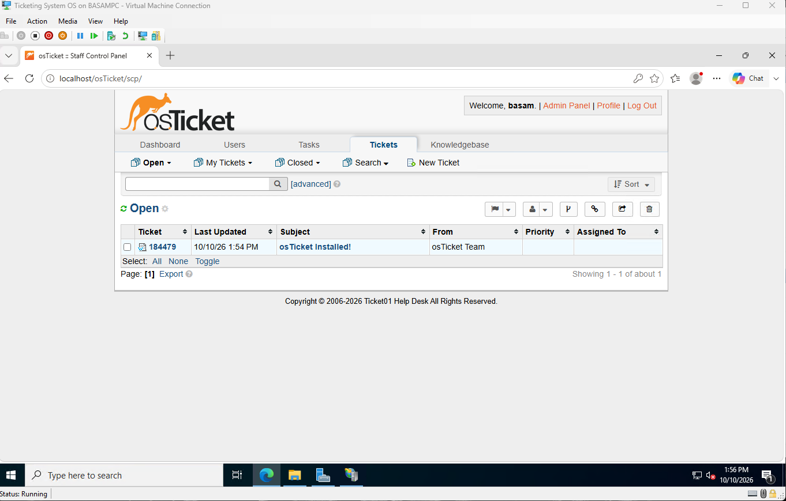

# osTicket Help Desk Home Lab

A self-hosted help desk ticketing system on Windows Server 2022 in Hyper-V.

## Environment

| Component | Value |
|---|---|
| Hypervisor | Hyper-V, Generation 2 VM, 4 GB RAM |
| OS | Windows Server 2022 Datacenter (Desktop Experience) |
| Hostname | TICKET01 |
| IP | 192.168.68.10 /22, static |
| Web server | IIS 10 with CGI |
| PHP | 8.3.35 x64 Non Thread Safe |
| Database | MySQL 8.4.11 LTS |
| Ticketing | osTicket 1.18.4 |

## How it fits together

- **IIS** serves the site.
- **PHP** runs the osTicket code. IIS hands PHP pages to it through CGI.
- **MySQL** stores tickets, users, and settings.
- **osTicket** is the app, sitting in the IIS web root.

## Build steps

1. [Virtual machine](docs/01-virtual-machine.md)
2. [Server prep](docs/02-server-prep.md)
3. [IIS](docs/03-iis.md)
4. [PHP](docs/04-php.md)
5. [MySQL](docs/05-mysql.md)
6. [osTicket install](docs/06-osticket-install.md)
7. [Help desk configuration](docs/07-configuration.md) - departments, routing, SLAs, agents, roles
8. [Ticket workflow](docs/08-ticket-workflow.md)
9. [Troubleshooting log](docs/troubleshooting.md)

## Status

- [x] VM built and networked
- [x] IIS, PHP, MySQL installed and verified
- [x] osTicket installed and locked down
- [x] Departments and help topic routing
- [x] SLA plans, agents, and role permissions
- [x] First ticket worked end to end
- [ ] Join TICKET01 to the Active Directory domain
- [ ] LDAP sign-in with AD accounts
- [ ] Work tickets against real AD accounts
