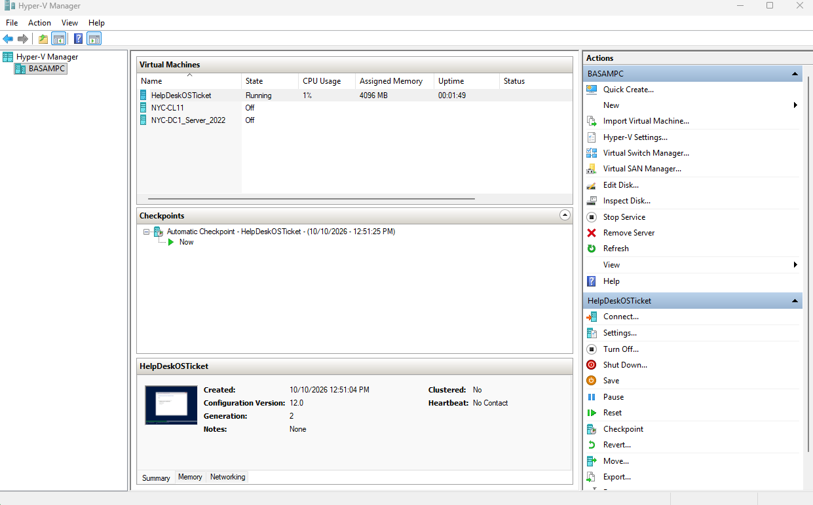
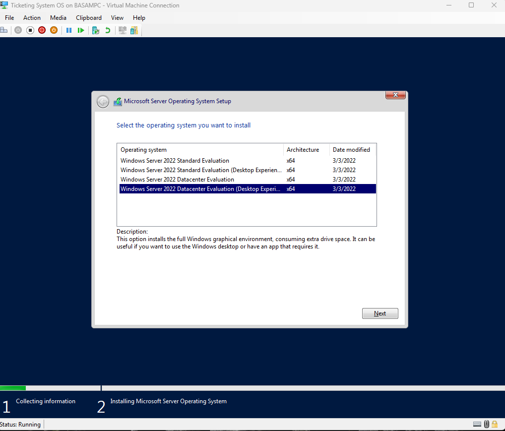
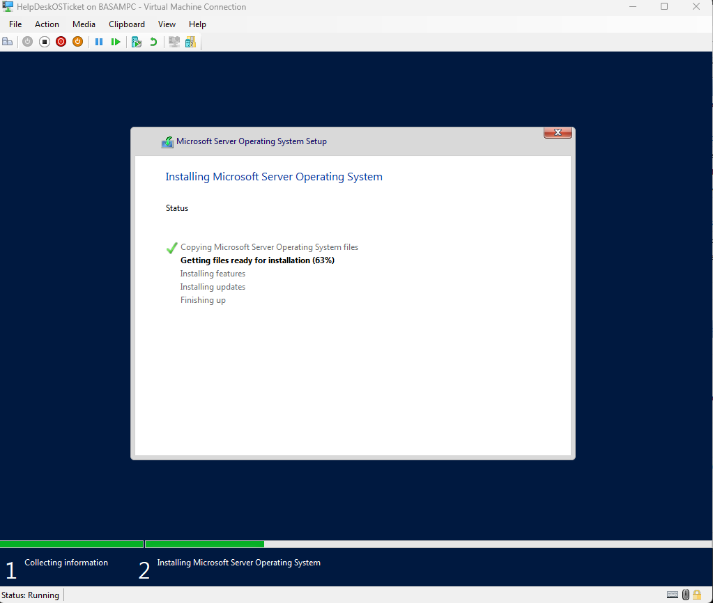

# 1. Virtual machine

Created a Generation 2 VM in Hyper-V with 4096 MB of RAM. It sits next to my existing domain controller and client VMs.

Installed Windows Server 2022 Datacenter with Desktop Experience, which gives the full GUI.

