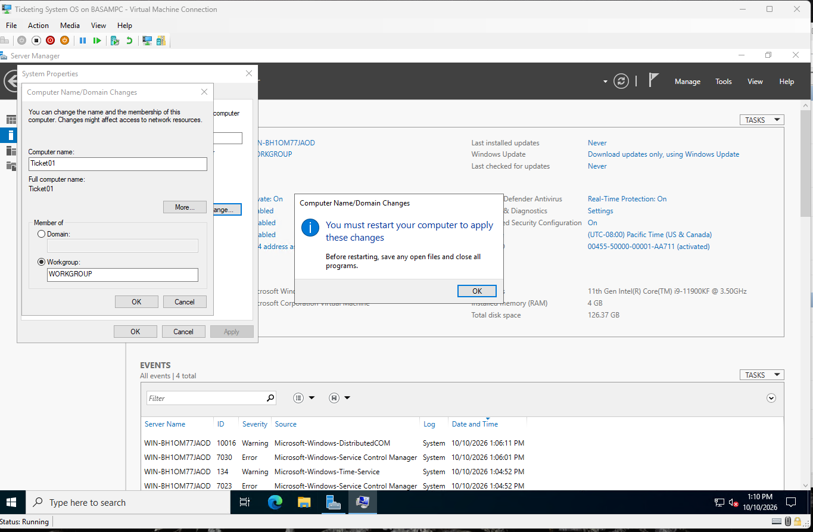
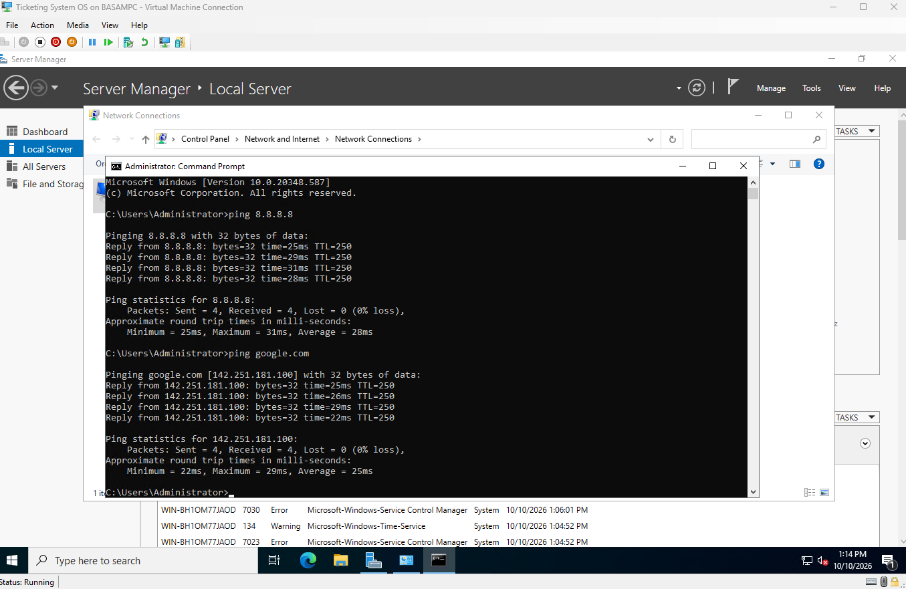

# 2. Server prep

## Rename

Renamed the server from the random default to `TICKET01`.

## Static IP

Servers need an address that doesn't change. Ran `ipconfig /all` to get the mask and gateway, then set:

| Setting | Value |
|---|---|
| IP address | 192.168.68.10 |
| Subnet mask | 255.255.252.0 |
| Default gateway | 192.168.68.1 |

Windows auto-filled the mask as 255.255.255.0. Corrected it to match ipconfig.

## Verify

`ping google.com` replies, so IP, gateway, and DNS all work.

## Also done

- Time zone set to Arizona. Kerberos fails if clocks are more than 5 minutes off.
- Hyper-V checkpoint taken before installing anything.
