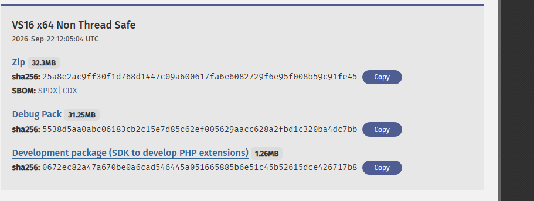
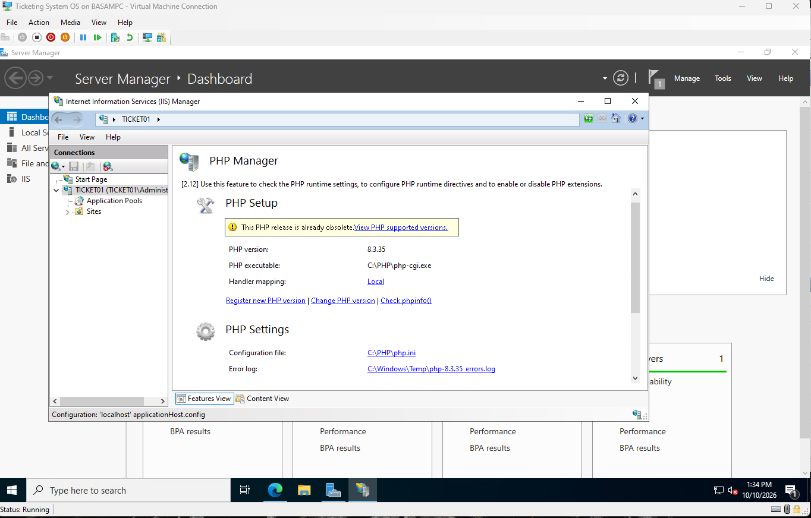
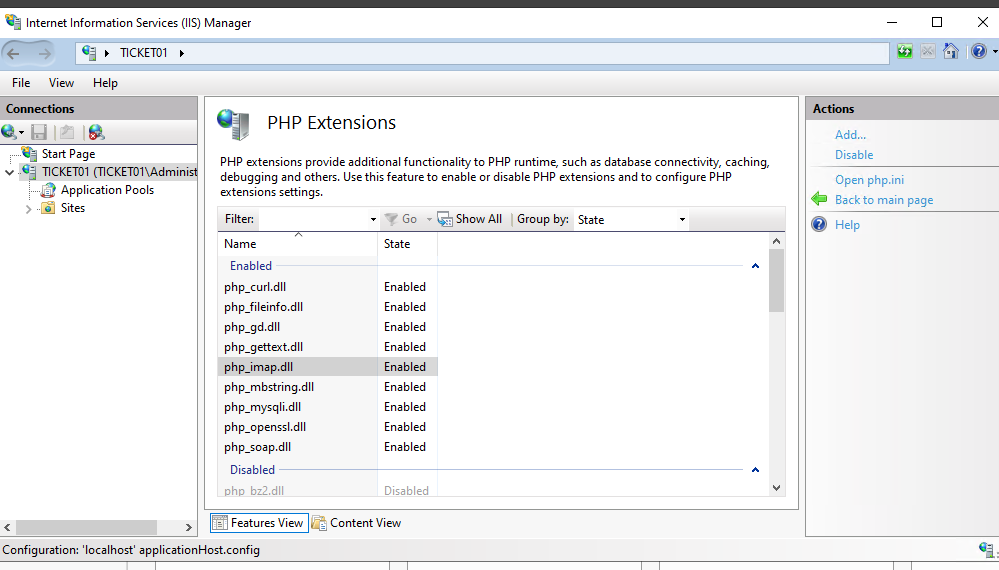
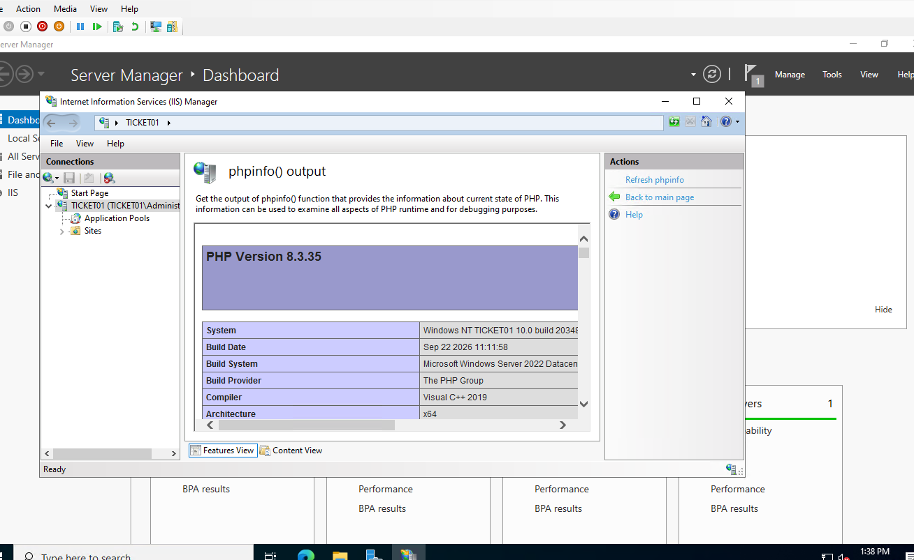

# 4. PHP

## Install

- Installed the Visual C++ 2015-2022 x64 runtime, which PHP requires.
- Downloaded PHP 8.3 **x64 Non Thread Safe**. osTicket 1.18 supports PHP 8.2 to 8.4, so 8.5 was too new.
- Extracted to `C:\PHP`.
- Copied `php.ini-production` to `php.ini`.

## Register with IIS

Installed PHP Manager for IIS and registered `C:\PHP\php-cgi.exe`.

## Extensions

Enabled: mysqli, gd, intl, mbstring, fileinfo, imap, curl, openssl, and ldap (for Active Directory login later).

## Verify

phpinfo loads through IIS and shows PHP 8.3.35 on TICKET01.

