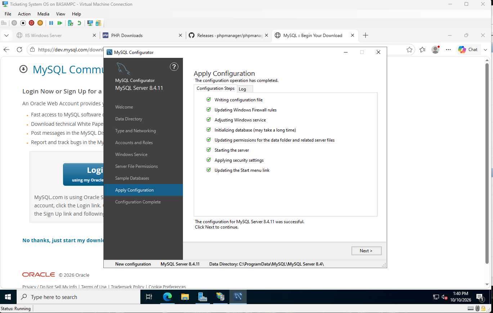
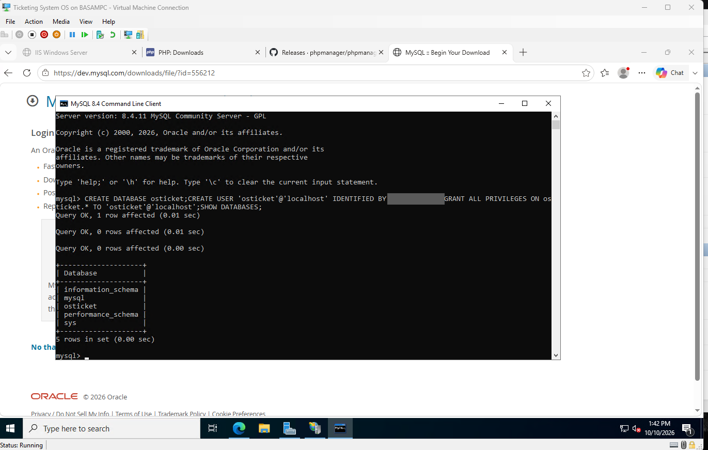

# 5. MySQL

Installed MySQL 8.4.11 LTS as a Windows service.



Created a database and a dedicated account for osTicket, so the app never uses root.

```sql
CREATE DATABASE osticket;
CREATE USER 'osticket'@'localhost' IDENTIFIED BY '<password>';
GRANT ALL PRIVILEGES ON osticket.* TO 'osticket'@'localhost';
SHOW DATABASES;
```


