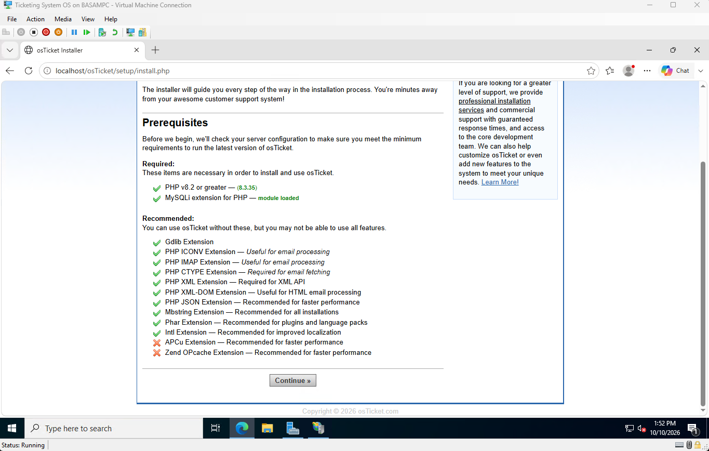
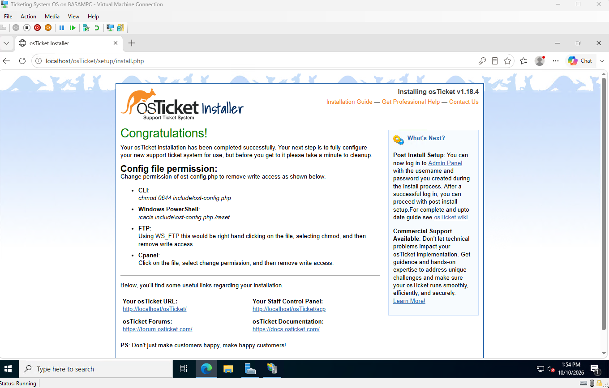

# 6. osTicket install

## Files

- Downloaded osTicket 1.18.4 from the official GitHub releases.
- Copied the `upload` folder contents to `C:\inetpub\wwwroot\osTicket`.
- Renamed `include\ost-sampleconfig.php` to `ost-config.php`.
- Gave IIS write access to that file so the installer can save settings:

```
icacls "C:\inetpub\wwwroot\osTicket\include\ost-config.php" /grant IUSR:M IIS_IUSRS:M
```

## Error 500.19

The first load failed. Fixed by installing the IIS URL Rewrite module. See the [troubleshooting log](troubleshooting.md).


## Installer

All required checks passed. APCu and OPcache are optional caches.



Entered the help desk name, admin account, and MySQL details.



## Lock down

- Removed write access from the config file:

```
icacls "C:\inetpub\wwwroot\osTicket\include\ost-config.php" /reset
```

- Deleted the `setup` folder so the installer can't be re-run.

## Result

- Staff panel: `http://localhost/osTicket/scp`
- User portal: `http://localhost/osTicket`


