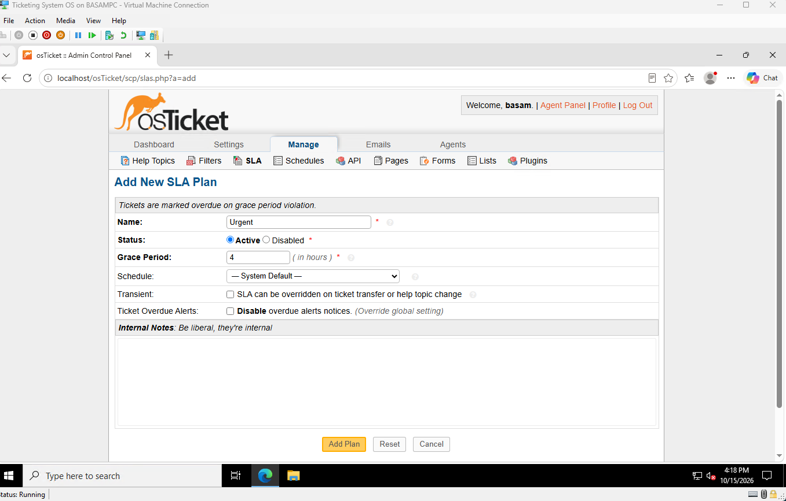
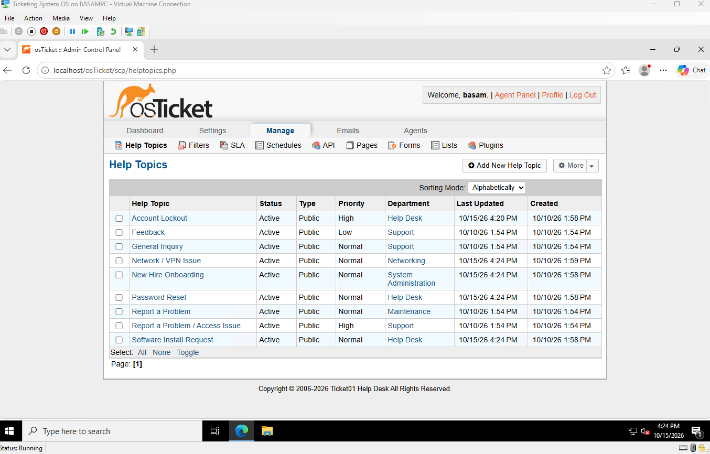
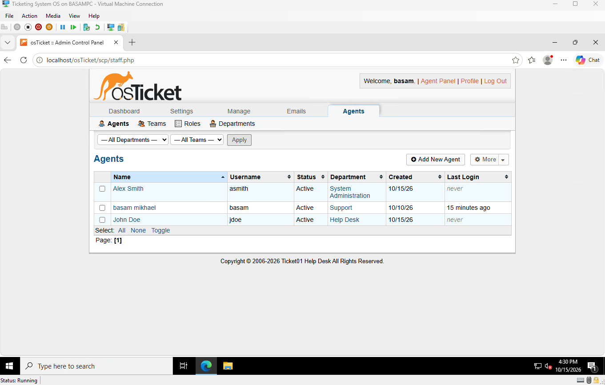
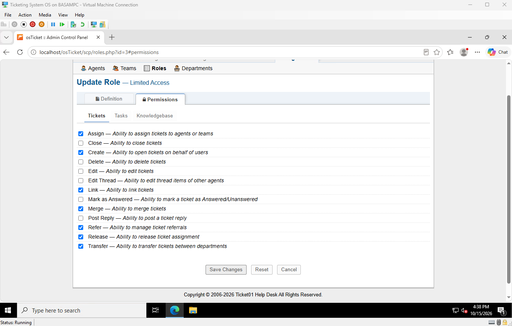

# 7. Help desk configuration

## Departments

Created Help Desk, System Administration, and Networking.

## Help topics

Each topic routes tickets to the right department automatically.

| Help topic | Routes to |
|---|---|
| Password Reset | Help Desk |
| Account Lockout | Help Desk |
| Software Install Request | Help Desk |
| New Hire Onboarding | System Administration |
| Network / VPN Issue | Networking |

Before, everything went to the default Support department:

After setting the department on each topic's "New ticket options" tab:

## SLA plans

| Plan | Grace period | Used by |
|---|---|---|
| Urgent | 4 hours | Account Lockout (High priority) |
| Standard | 24 hours | All other topics (Normal priority) |

Only Account Lockout is High. A locked-out user can't work at all.

## Agents

| Agent | Username | Department | Role |
|---|---|---|---|
| John Doe | jdoe | Help Desk | Limited Access (tier 1) |
| Alex Smith | asmith | System Administration | Expanded Access |

- Passwords set directly (no mail server for reset emails).
- "Require password change at next login" left on.

## Role permissions

Added Post Reply and Close to Limited Access so tier 1 can answer and resolve tickets. Left Delete, Edit, and Edit Thread off (least privilege).

