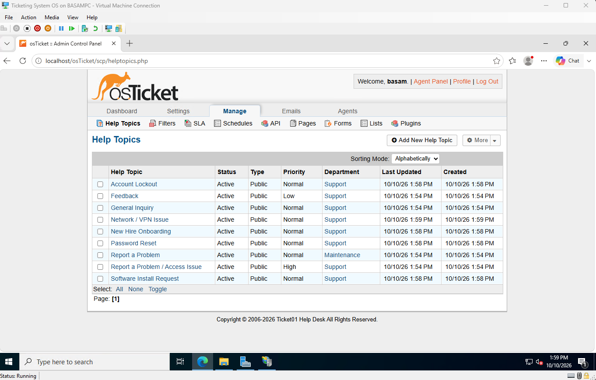
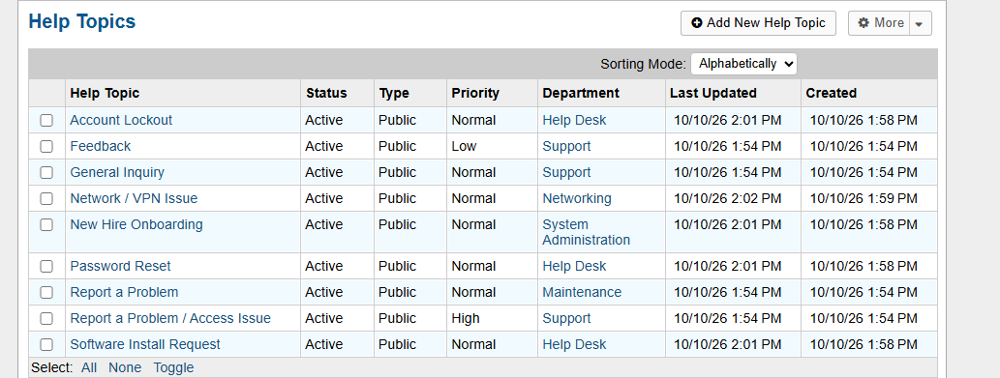

# 7. Help desk configuration

## Departments

Created Help Desk, System Administration, and Networking.

## Help topics

Each topic routes tickets to the right department automatically.

| Help topic | Routes to |
|---|---|
| Password Reset | Help Desk |
| Account Lockout | Help Desk |
| Software Install Request | Help Desk |
| New Hire Onboarding | System Administration |
| Network / VPN Issue | Networking |

Before, everything went to the default Support department:

After setting the department on each topic's "New ticket options" tab:

