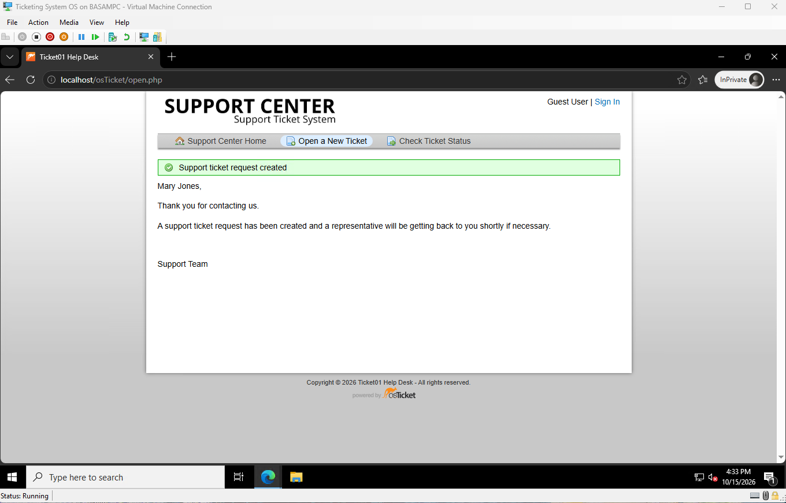
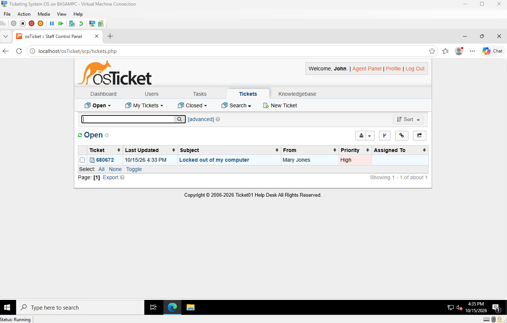
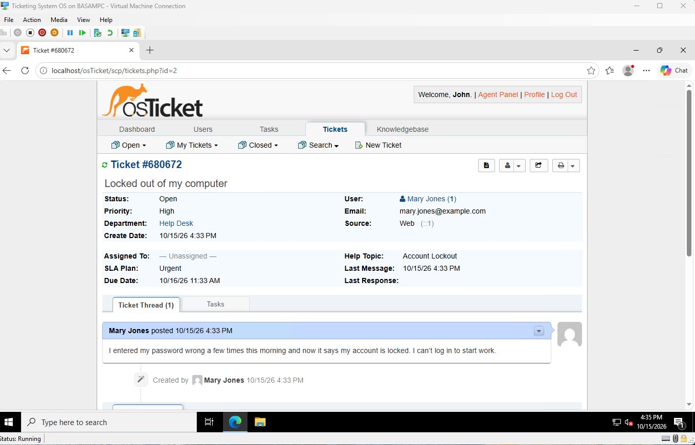
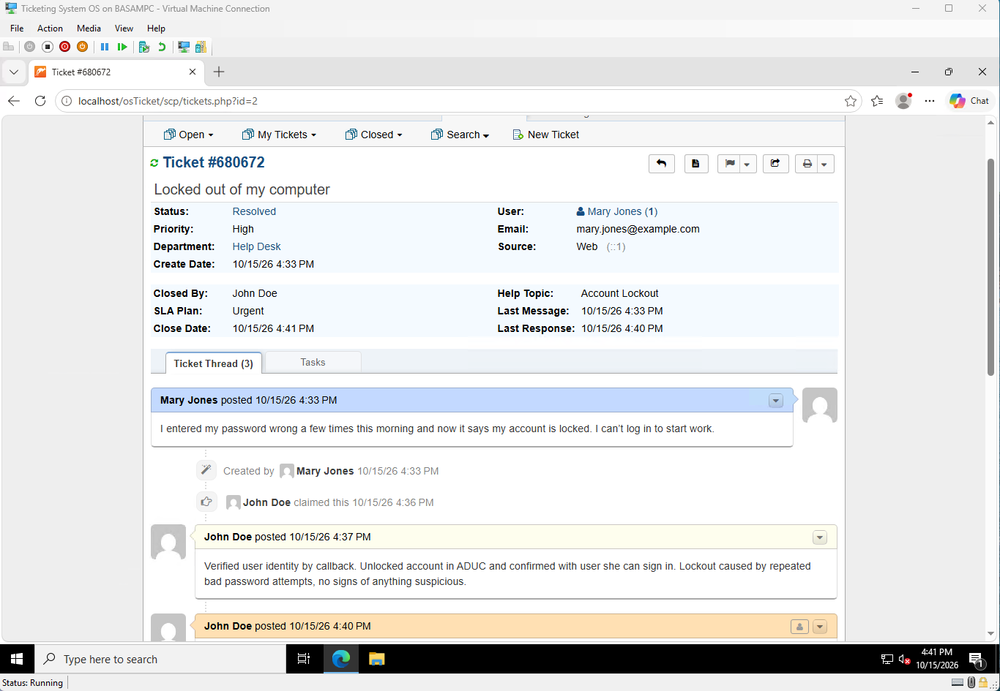
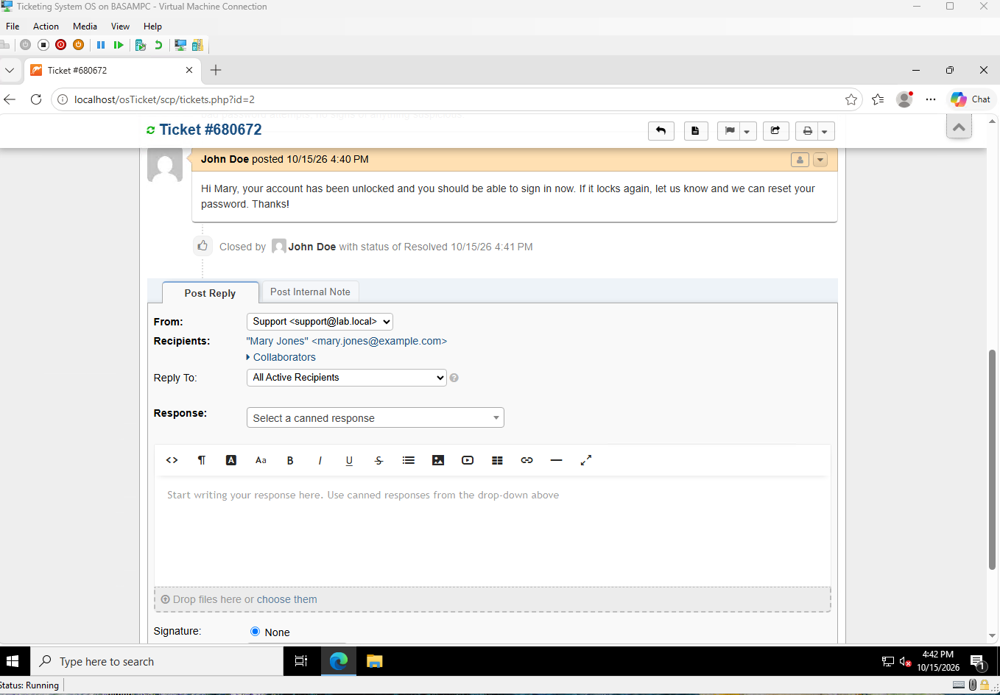

# 8. Ticket workflow

First ticket run end to end: user submits, it routes, a tech works it, it gets resolved.

## Submit

Submitted from the user portal as a test employee, help topic Account Lockout.

## Routing

Logged in as `jdoe` (Help Desk). The ticket landed in his queue as High priority with no manual triage.

## SLA

Urgent plan, 4-hour grace period. Due date is the next morning because the SLA counts business hours (8 to 5): 27 minutes left that day, the rest the next morning.

## Work it

1. Claimed the ticket.
2. Posted an internal note (staff only) with what was done.
3. Replied to the user.
4. Set status to Resolved.

## Note

The fix in this ticket was simulated. Once TICKET01 is on the domain, tickets will be worked against real AD accounts.
