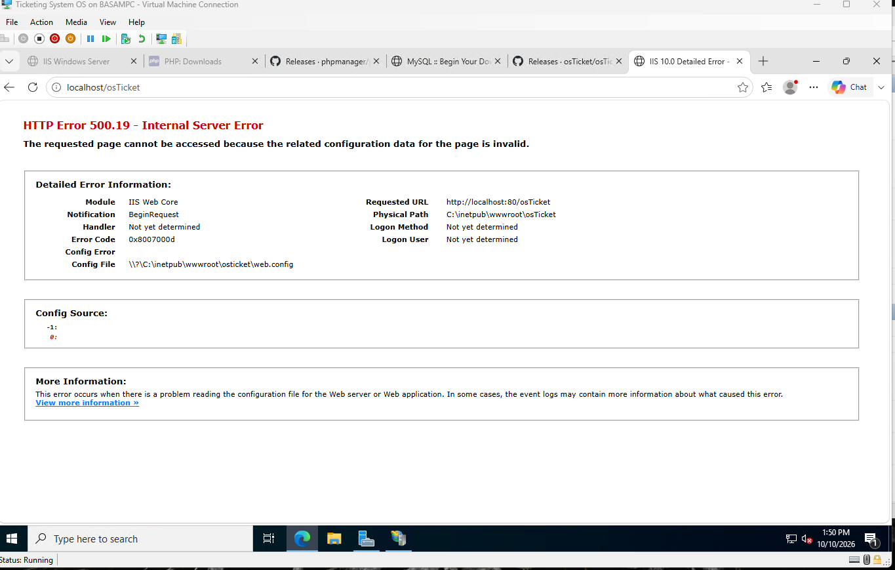
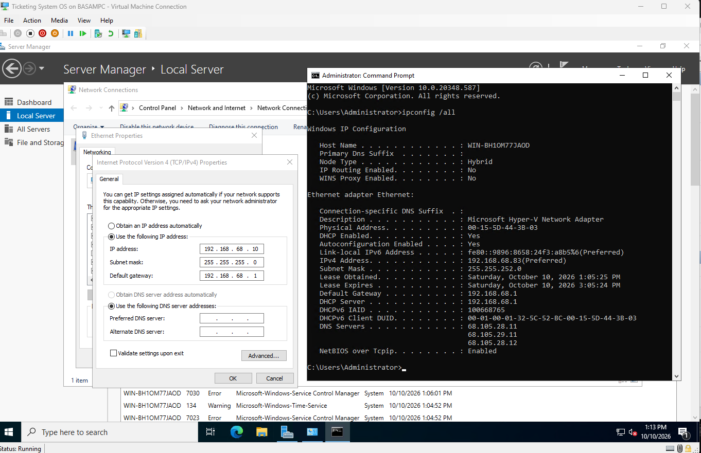

# Troubleshooting log

## HTTP Error 500.19 on first load

- **Symptom:** `http://localhost/osTicket` returned 500.19, code `0x8007000d`, pointing at `web.config`.
- **Cause:** osTicket's `web.config` uses URL rewrite rules, and IIS doesn't include the URL Rewrite module by default.
- **Fix:** Installed URL Rewrite Module 2.1 (x64) and ran `iisreset`.

## Subnet mask auto-filled wrong

- **Symptom:** Windows filled in 255.255.255.0 for the static IP.
- **Cause:** Windows assumes a /24 for 192.168.x.x. This network is a /22.
- **Fix:** Changed it to 255.255.252.0 to match `ipconfig /all`.

## Help topics all routing to Support

- **Symptom:** Every new help topic showed Support as its department.
- **Cause:** The Department dropdown is on the "New ticket options" tab, which I missed.
- **Fix:** Set the department on that tab for each topic.

## Red X on APCu and OPcache

- **Symptom:** Two failed checks under "Recommended" in the installer.
- **Cause:** Optional performance caches that aren't enabled.
- **Fix:** None needed. Everything under "Required" passed.
